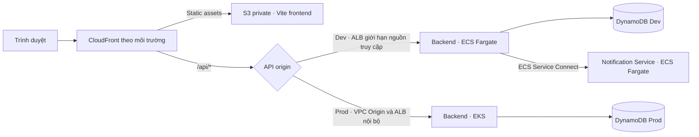

# TikTo Calendar

TikTo là ứng dụng quản lý công việc, lịch sự kiện và thông báo. Giao diện web, API và Notification Service nằm ở các repository riêng, với hạ tầng AWS được quản lý bằng Terraform.

## Kiến trúc

CloudFront phục vụ giao diện và `/api/*` trên cùng một origin phía trình duyệt. Backend Node.js/Express xử lý task và event, lưu dữ liệu vào DynamoDB và gọi Notification Service qua HTTP. Notification Service dùng Python và lưu trạng thái thông báo trong bộ nhớ tiến trình.

Terraform chia thành ba stack. `shared` quản lý VPC, ECR và các IAM role dùng chung cho GitHub Actions. `dev` và `prod` đọc output của `shared`, đồng thời có Terraform state và bảng DynamoDB riêng. GitHub Actions dùng OIDC để lấy quyền AWS tạm thời. Backend dùng ECS task role ở Dev và EKS Pod Identity ở Prod để truy cập bảng của môi trường tương ứng.

Trong Prod, Terraform dựng EKS và CloudWatch Observability. GitOps quản lý workload và ALB nội bộ. Sau khi ALB được tạo, Terraform có thể bật CloudFront VPC Origin để đưa `/api/*` vào cụm.

## Luồng CI/CD

Các repository ứng dụng khai báo sự kiện và môi trường triển khai. Workflow dùng chung chạy các bước kiểm tra Node.js/Python và cung cấp các bước publish, deploy và promote container cho Backend.

| Thành phần | CI cho PR vào `dev` | Sau khi push vào `dev` | Phát hành production |
| --- | --- | --- | --- |
| Frontend | Format, lint, test và build khi có thay đổi thuộc phạm vi CI. PR đủ điều kiện có thể được squash-merge tự động sau khi CI đạt. | Kiểm tra mã nguồn, build Vite, quét Trivy, upload assets lên S3 trước `index.html`, rồi invalidate CloudFront. Chạy theo bộ lọc đường dẫn. | Chạy **Release production** từ `dev` với version mới. Workflow kiểm tra source, đi qua GitHub Environment `prod`, build lại, deploy lên S3/CloudFront Prod rồi tạo GitHub Release. |
| Backend | Format, lint, test và kiểm tra cú pháp chạy song song. Kết quả tập trung ở `checks / CI result`, sau đó merge thủ công. | Build và quét image bằng Trivy, push tag `sha-<full SHA>` lên ECR. Deploy bằng digest lên ECS và xác nhận đúng task revision đã rollout. | Push tag `vX.Y.Z` trên đúng commit đã deploy Dev thành công và có mặt trên cả `dev` lẫn `main`. Qua GitHub Environment `prod`, workflow gắn version cho digest đã kiểm chứng và mở PR GitOps. |
| Notification Service | Format, lint, test và compile khi có thay đổi thuộc phạm vi CI. PR đủ điều kiện có thể được squash-merge tự động sau khi CI đạt. | Kiểm tra mã nguồn, build và quét image, rồi publish `dev-<12 ký tự SHA>` lên ECR. Chạy theo bộ lọc đường dẫn. | Chạy **Release production** từ `dev` với version mới. Qua GitHub Environment `prod`, workflow lấy image Dev tương ứng, quét lại bằng Trivy, publish tag `vX.Y.Z` và tạo GitHub Release. |

**Backend production** chỉ bắt đầu rollout sau khi PR GitOps được merge. Argo CD đồng bộ thay đổi vào EKS. Kiểm tra trạng thái đồng bộ và sức khỏe workload trong Argo CD để xác nhận triển khai. Có thể rollback phiên bản ứng dụng bằng cách revert thay đổi image trong GitOps.

**Notification Service** hoàn tất ở bước phát hành image. Việc cập nhật workload chạy image mới cần bước triển khai riêng.

**Hạ tầng** chạy `terraform fmt` và `terraform validate` khi PR chạm vào cấu hình Terraform. Chạy thủ công workflow **Terraform validate and plan** để xem plan của `shared`, `dev` và `prod` dựa trên state hiện tại. `terraform apply` là bước vận hành riêng sau khi review plan.

## Repositories

| Repository | Phạm vi |
| --- | --- |
| [frontend](https://github.com/tikto-calender/frontend) | Giao diện Vite và triển khai S3/CloudFront |
| [backend](https://github.com/tikto-calender/backend) | Express API, DynamoDB và tích hợp thông báo |
| [notification-service](https://github.com/tikto-calender/notification-service) | API thông báo bằng Python và pipeline phát hành image |
| [infra](https://github.com/tikto-calender/infra) | Terraform cho AWS edge, ECS, EKS, IAM và DynamoDB |
| [reusable-workflow](https://github.com/tikto-calender/reusable-workflow) | Workflow GitHub Actions dùng chung |
