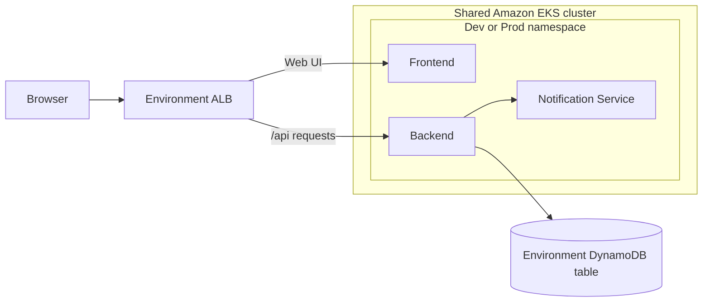
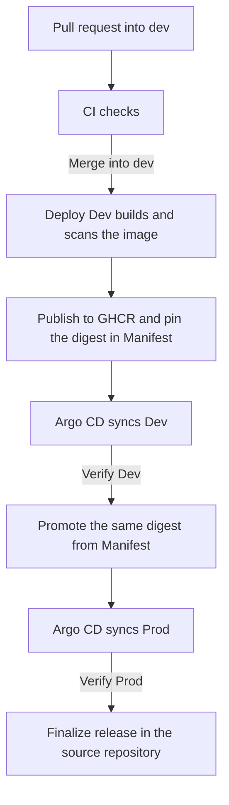

# TikTo Calendar

TikTo Calendar is a web app for managing tasks and calendar events. Its dashboard shows upcoming work, service health and component versions, and lets you send a test notification.

## Cloud architecture

Dev and Prod share one Amazon EKS cluster in Sydney (`ap-southeast-2`). Each environment has its own namespace, Application Load Balancer (ALB) and DynamoDB table. Backend accesses its table through EKS Pod Identity.

Terraform or CloudFormation provisions the AWS resources. Argo CD deploys the Helm chart from the Manifest repository.

## CI/CD workflow

CI checks formatting, lint, tests and build or syntax. **Finalize release** tags the deployed source commit and creates the GitHub Release. [Shared workflows](https://github.com/tikto-calender/reusable-workflow)

All three services use the same promotion workflow. Argo CD applies the updated image digest and Kubernetes rolls out the Deployment. [Promotion guide](https://github.com/tikto-calender/manifest#promote-to-production)

## Repositories

| Repository | Purpose |
| --- | --- |
| [Frontend](https://github.com/tikto-calender/frontend) | Vite web app and dashboard |
| [Backend](https://github.com/tikto-calender/backend) | Express API, task and event storage, and notification integration |
| [Notification Service](https://github.com/tikto-calender/notification-service) | Python notification API and test alerts |
| [Terraform](https://github.com/tikto-calender/infra) | AWS platform and EKS setup |
| [CloudFormation](https://github.com/tikto-calender/infra-by-cloudformation) | AWS platform with separate data and runtime stacks |
| [Manifest](https://github.com/tikto-calender/manifest) | Helm chart, Argo CD applications and Prod promotion workflows |
| [Reusable Workflows](https://github.com/tikto-calender/reusable-workflow) | Shared CI, image publishing and release jobs |

## Run locally

With Node.js 24 or 22.13+ on the 22.x line, run `npm ci` and `npm run dev` in the Backend and Frontend repositories in separate terminals. Backend uses local JSON storage and Vite proxies API requests to port 3000. Open the app at [http://localhost:5173](http://localhost:5173).

For the full demo, start the [Notification Service](https://github.com/tikto-calender/notification-service) on port 8000 and set `NOTIFICATION_SERVICE_URL=http://localhost:8000` in Backend's environment.
